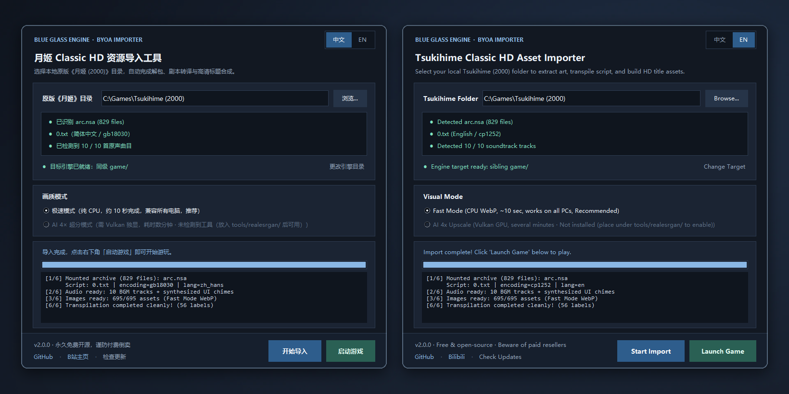
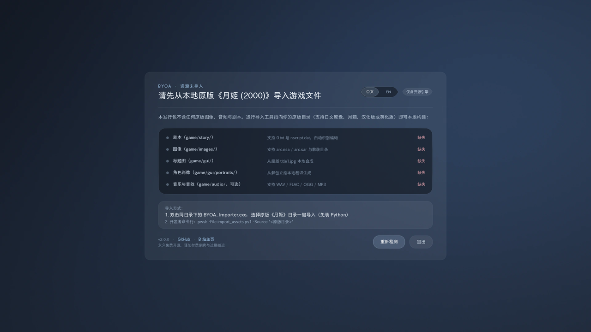
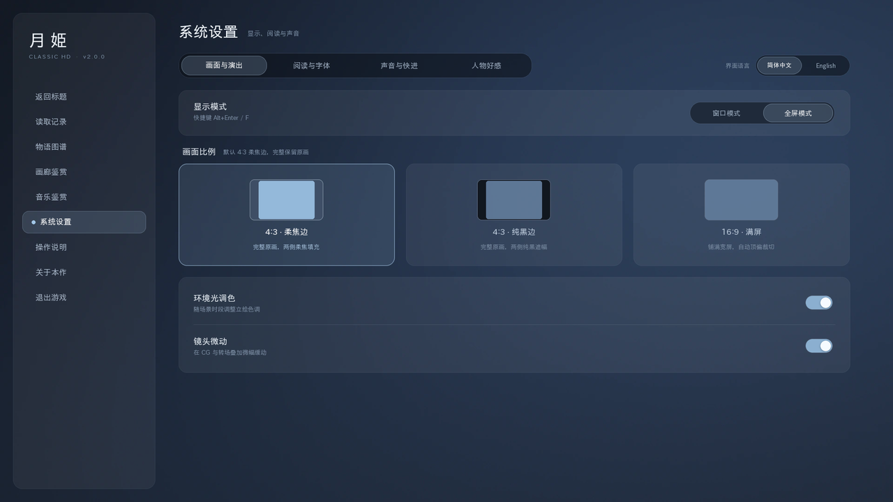
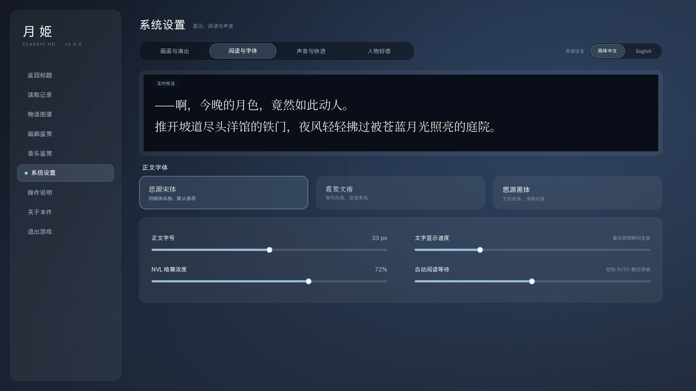
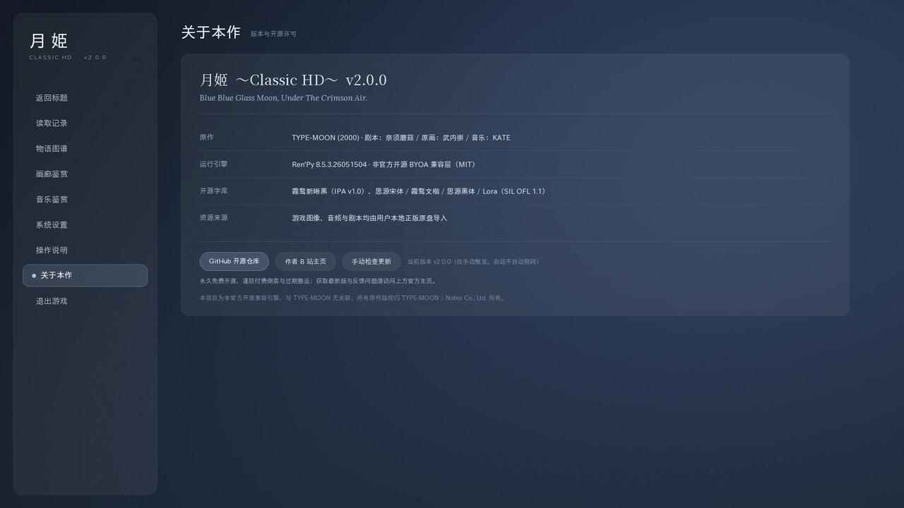

# Blue Glass Engine — 月姬 Classic HD（非官方开源 BYOA 兼容引擎）

[简体中文](README.md) | [English](README_EN.md) · [Releases 下载](https://github.com/En-nagakiro/BlueGlassHD/releases) · [B站实机演示](https://www.bilibili.com/video/BV1qb14zTECv/) · [作者 B站主页](https://space.bilibili.com/1601243445)

基于 Ren'Py 8.5.3 编写的非官方开源兼容引擎，用于在现代 1080P/2K 显示器上运行用户本地合法持有的 2000 年版《月姬（Tsukihime）》。

> **版权与合规声明**
> 本仓库及发行包仅包含自研引擎代码、程序化 UI 贴图、程序合成界面音效与开源字库，**不包含任何 TYPE-MOON 原版图像、音频、剧本或商业字体**。游玩前须通过内置 BYOA（Bring Your Own Assets）导入工具读取你本地合法持有的原版游戏文件。

---

## 界面预览

以下截图均直接截取自未导入原盘的纯开源引擎与 `BYOA_Importer.exe`，不含任何原作素材。实机剧情、图谱与标题演出可观看 [B站实机演示视频](https://www.bilibili.com/video/BV1qb14zTECv/)。



| 首次运行 BYOA 引导与资源检测 | 4:3 原画柔焦 / 黑边 / 16:9 显示设置 |
| :---: | :---: |
|  |  |

| 三套开源字库与 NVL 实时排版预览 | 版本信息、开源声明与手动检查更新 |
| :---: | :---: |
|  |  |

---

## 主要特性

- **零依赖图形导入器（`BYOA_Importer.exe`）**：Windows 玩家下载解压发行包后，双击同目录下的 `BYOA_Importer.exe` 选中原版目录即可完成解包、剧本转译与标题合成，无需安装 Python 或 Ren'Py。
- **多版本原盘兼容**：支持 `arc.nsa` / `arc.sar` 及散装 `image/` 目录，支持明文 `0.txt` 与 XOR 加密 `nscript.dat` 自动解码（Shift-JIS / CP932 / GB18030 / Big5 / UTF-8），自动兼容 WAV / FLAC / OGG / MP3 原声音乐。
- **中英双语界面**：导入器、首次运行引导页与游戏内全部菜单均内置「简体中文 / English」实时切换（首次启动自动跟随系统语言）。
- **全高清 NVL 阅读体验**：默认全屏启动（`F` / `Alt+Enter` 切换窗口）；默认 4:3 完整无裁切原画 + 两侧柔焦氛围边，支持设置页实时切换 4:3 纯黑边或 16:9 满屏；内置思源宋体 / 霞鹜文楷 / 思源黑体三套开源正文字体。
- **重构附加系统**：54 节点五线物语分支图谱（支持直跳续玩）、五女主磨砂好感卡片、自动收录 4:3 无裁切 CG 画廊、10 曲音乐鉴赏室（返回主菜单不打断播放）与全五线通关后的动态「月蝕」标题画面。
- **克制联网边界**：默认离线运行，启动不产生后台联网请求；仅在「关于本作」或导入器页脚点击「检查更新」时才会访问 GitHub Releases。

---

## 玩家使用方式（推荐）

从 [Releases 最新版](https://github.com/En-nagakiro/BlueGlassHD/releases/latest) 下载 `BlueGlassHD-2.0.3-win-BYOA.zip`（提供 `.sha256` 校验文件）并解压，根目录结构如下：

```text
BlueGlassHD-2.0.3-win/
├── BlueGlassHD.exe          # 游戏主程序
├── BYOA_Importer.exe        # 图形资源导入工具（中/英双语）
├── game/                    # 开源引擎与 OFL/IPA 字库
├── lib/ & renpy/            # Ren'Py 8.5.3 运行时
├── LICENSE
├── THIRD_PARTY_LICENSES.md
└── README_使用说明.txt
```

1. 双击 `BYOA_Importer.exe`。因独立可运行工具未购买商业代码签名证书，Windows SmartScreen 可能会弹出提示，选择「更多信息 → 仍要运行」即可。
   > **源码透明说明**：导入器全部源码（[byoa_gui.py](scripts/byoa_gui.py)、[byoa_import.py](scripts/byoa_import.py)）与打包脚本（[build_importer_exe.py](scripts/build_importer_exe.py)）均已完整开源；如果你不希望运行预编译 `.exe`，也可以直接审阅源码或使用下方 `import_assets.ps1` 从源码本地导入。
2. 点击「浏览...」选中本地原版《月姬 (2000)》目录，等待封包、剧本、原声三项体检通过。
3. 点击右下角「开始导入」（极速模式约 10 秒完成；若本地配有 Vulkan `realesrgan-ncnn-vulkan`，可选 AI 4× 超分模式）。
4. 导入完成后点击「启动游戏」（或直接双击 `BlueGlassHD.exe`）。

### 可选：启用 AI 4× 超分（需支持 Vulkan 的显卡）

为控制发行包体积并保证无独立显卡设备开箱即用，发行包默认未内置超分工具。如需开启 AI 4× 超分（`realesrgan-x4plus-anime`）：

1. 前往官方页面 [xinntao/Real-ESRGAN v0.2.5.0](https://github.com/xinntao/Real-ESRGAN/releases/tag/v0.2.5.0) 下载 `realesrgan-ncnn-vulkan-20220424-windows.zip`。
2. 将压缩包内的 `realesrgan-ncnn-vulkan.exe` 与 `models/` 目录放入解压后的 `tools/realesrgan/` 路径（即 `BYOA_Importer.exe` 同级的 `tools\realesrgan\`）：
   ```text
   BlueGlassHD-2.0.3-win/
   ├── BYOA_Importer.exe
   └── tools/
       └── realesrgan/
           ├── realesrgan-ncnn-vulkan.exe
           └── models/
   ```
3. 重新打开 `BYOA_Importer.exe`，画质栏中的「AI 4× 超分」即可勾选使用（也可以将工具目录加入系统 `PATH`）。

---

## 开发者构建与校验

环境要求：Python 3.10+（`pillow`、`numpy`）与 Ren'Py 8.5.3 SDK（置于 `tools/renpy_sdk/renpy-8.5.3-sdk/`）。

```powershell
# 1. 从本地原版目录导入资产至开发目录 Tsukihime_HD/
pwsh -File import_assets.ps1 -Source "C:\Games\Tsukihime"

# 2. 运行 7 项完整性检查与 Ren'Py 8.5.3 官方 lint
python scripts/verify_project.py

# 3. 开源合规审计（验证 .gitignore、字库许可、零本机路径泄漏）
python scripts/verify_project.py --compliance-audit

# 4. 启动开发预览
pwsh -File launch_tsukihime.ps1

# 5. 构建独立 BYOA_Importer.exe 与扁平零版权玩家发行包
python scripts/build_importer_exe.py
python scripts/build_release_package.py
```

---

## 开源许可

- 引擎与工具源码：[MIT License](LICENSE)
- 第三方依赖与开源字库声明：[THIRD_PARTY_LICENSES.md](THIRD_PARTY_LICENSES.md) 与 [game/fonts/LICENSES.txt](Tsukihime_HD/game/fonts/LICENSES.txt)
- 《月姬（Tsukihime）》原作版权归 TYPE-MOON / Notes Co., Ltd. 所有，本项目为非官方粉丝开源兼容层，与版权方无关联。
