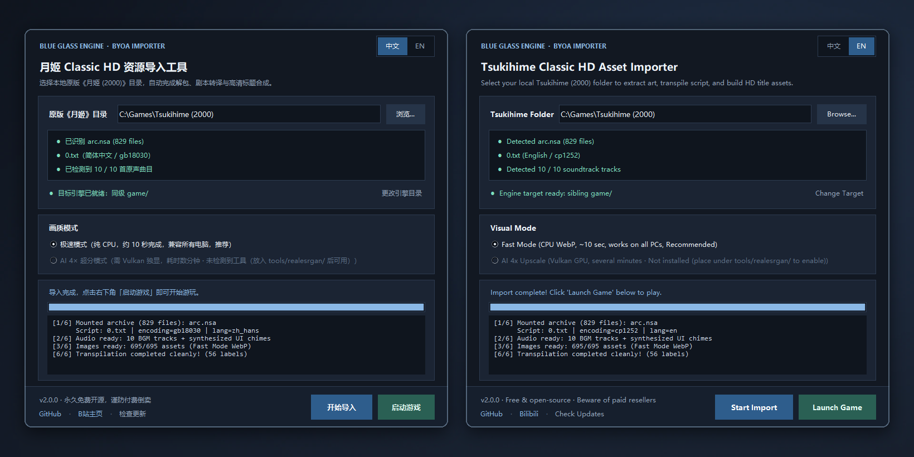
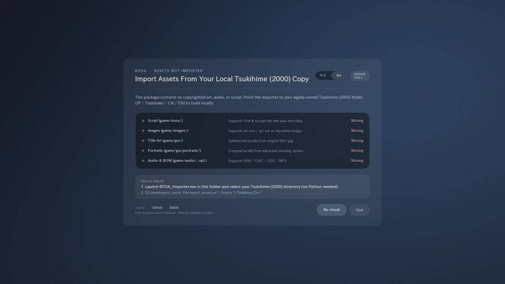
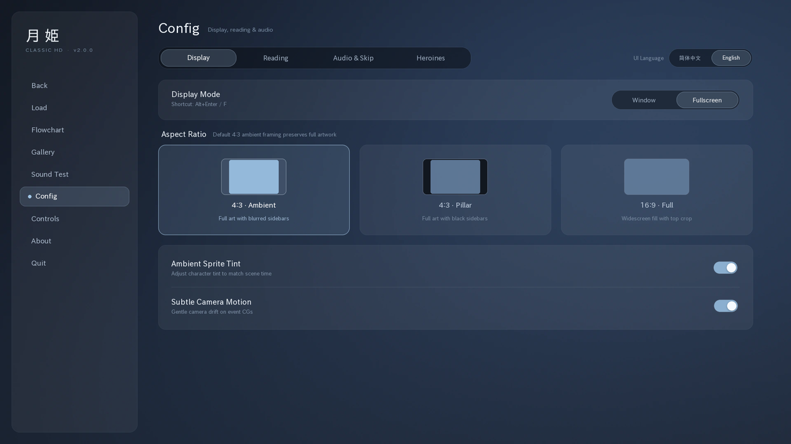
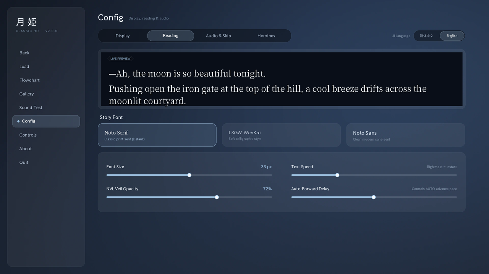
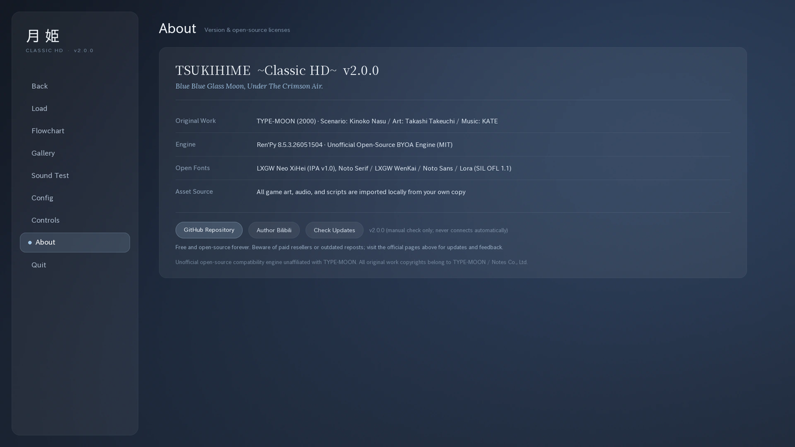

# Blue Glass Engine — Tsukihime Classic HD (Unofficial Open-Source BYOA Engine)

[简体中文](README.md) | [English](README_EN.md) · [Releases](https://github.com/En-nagakiro/BlueGlassHD/releases) · [Showcase Video (Bilibili)](https://www.bilibili.com/video/BV1qb14zTECv/) · [Author Bilibili](https://space.bilibili.com/1601243445)

An unofficial open-source Ren'Py 8.5.3 compatibility engine for playing legally owned copies of the original 2000 visual novel *Tsukihime* at modern 1080p/1440p resolutions.

> **Copyright & BYOA Notice**
> This repository and its release packages contain only original engine code, procedural UI textures, synthesized UI chimes, and open-source fonts. **No copyrighted TYPE-MOON artwork, audio, scripts, or proprietary fonts are included.** You must supply your own legally owned copy of *Tsukihime (2000)* using the built-in BYOA (Bring Your Own Assets) importer.

---

## UI Preview

All screenshots below are captured directly from the un-imported open-source engine and `BYOA_Importer.exe`, containing zero copyrighted original assets. For live in-game gameplay, flowchart, and title screen footage, watch the [Showcase Video (Bilibili)](https://www.bilibili.com/video/BV1qb14zTECv/).



| First-Run BYOA Setup & Asset Verification | Display & Aspect Ratio Settings (4:3 Ambient / 16:9) |
| :---: | :---: |
|  |  |

| Open-Source Reading Fonts & Live NVL Preview | Version, Licenses & Manual Update Check |
| :---: | :---: |
|  |  |

---

## Key Features

- **Standalone GUI Importer (`BYOA_Importer.exe`)**: Windows users simply unzip the release archive, launch `BYOA_Importer.exe`, and pick their local *Tsukihime (2000)* directory. No Python or Ren'Py installation is required.
- **Multi-Edition Compatibility**: Reads `arc.nsa`, `arc.sar`, or unpacked `image/` folders; decodes plain `0.txt` and XOR-encrypted `nscript.dat` across Shift-JIS / CP932 / GB18030 / Big5 / UTF-8 (JP original, Tsukibako, CN, and EN patch editions); resolves WAV / FLAC / OGG / MP3 soundtrack files automatically.
- **Bilingual UI (Chinese / English)**: Both `BYOA_Importer.exe`, the first-run BYOA gate, and all in-game menus support instant live switching between Chinese and English (auto-detecting OS locale on first launch).
- **1080p NVL Reading Experience**: Launches fullscreen by default (`F` / `Alt+Enter` toggles windowed mode); defaults to uncropped 4:3 artwork with blurred ambient sidebars, with live switching to 4:3 pillarbox or 16:9 widescreen fill; bundles open-source Noto Serif, LXGW WenKai, and Noto Sans reading fonts.
- **Rebuilt Companion Systems**: 54-node 5-route chronological Flowchart with direct branch jumping, live 5-heroine affection portrait cards, auto-unlocking 4:3 uncropped CG Gallery, 10-track Sound Test (persists cleanly when returning to the main menu), and an animated post-clear **Eclipse** title screen.
- **Zero Background Network Calls**: Offline by default on startup; network requests occur only when manually clicking **Check Updates** in the About screen or importer footer.

---

## Player Quick Start (Recommended)

Download and extract `BlueGlassHD-2.0.0-win-BYOA.zip` (with `.sha256` checksum) from [Releases](https://github.com/En-nagakiro/BlueGlassHD/releases):

```text
BlueGlassHD-2.0.0-win/
├── BlueGlassHD.exe          # Game executable
├── BYOA_Importer.exe        # Bilingual GUI asset importer
├── game/                    # Open-source engine & OFL/IPA fonts
├── lib/ & renpy/            # Ren'Py 8.5.3 runtime
├── LICENSE
├── THIRD_PARTY_LICENSES.md
└── README_使用说明.txt
```

1. Launch `BYOA_Importer.exe`. Because this open-source utility is not signed with a paid EV certificate, Windows SmartScreen may show a prompt — choose *More info → Run anyway*.
   > **Build Transparency**: Full source code for the importer ([byoa_gui.py](scripts/byoa_gui.py), [byoa_import.py](scripts/byoa_import.py)) and PyInstaller build script ([build_importer_exe.py](scripts/build_importer_exe.py)) are in this repository. If you prefer not to run prebuilt `.exe` binaries, you can audit the code or import directly from source using `import_assets.ps1`.
2. Click **Browse...** and select your local *Tsukihime (2000)* folder; wait for the archive, script, and audio checks to turn green.
3. Click **Start Import** at the bottom right (~10 seconds in CPU Fast Mode; optional 4× Vulkan AI upscaling if `realesrgan-ncnn-vulkan` is installed).
4. Click **Launch Game** (or run `BlueGlassHD.exe`).

---

## Developer Build & Verification

Requirements: Python 3.10+ (`pillow`, `numpy`) and Ren'Py 8.5.3 SDK placed under `tools/renpy_sdk/renpy-8.5.3-sdk/`.

```powershell
# 1. Import assets from your local copy into Tsukihime_HD/
pwsh -File import_assets.ps1 -Source "C:\Games\Tsukihime"

# 2. Run all 7 integrity checks + official Ren'Py 8.5.3 lint
python scripts/verify_project.py

# 3. Run open-source compliance audit (.gitignore, font licenses, zero local-path leaks)
python scripts/verify_project.py --compliance-audit

# 4. Launch development preview
pwsh -File launch_tsukihime.ps1

# 5. Build standalone BYOA_Importer.exe & flat zero-asset Windows release ZIP
python scripts/build_importer_exe.py
python scripts/build_release_package.py
```

---

## Licenses

- Engine & importer source code: [MIT License](LICENSE)
- Third-party components & open-source fonts: [THIRD_PARTY_LICENSES.md](THIRD_PARTY_LICENSES.md) and [game/fonts/LICENSES.txt](Tsukihime_HD/game/fonts/LICENSES.txt)
- *Tsukihime* and all original assets are copyright TYPE-MOON / Notes Co., Ltd. This project is an independent, unofficial open-source compatibility layer and is not affiliated with TYPE-MOON.
